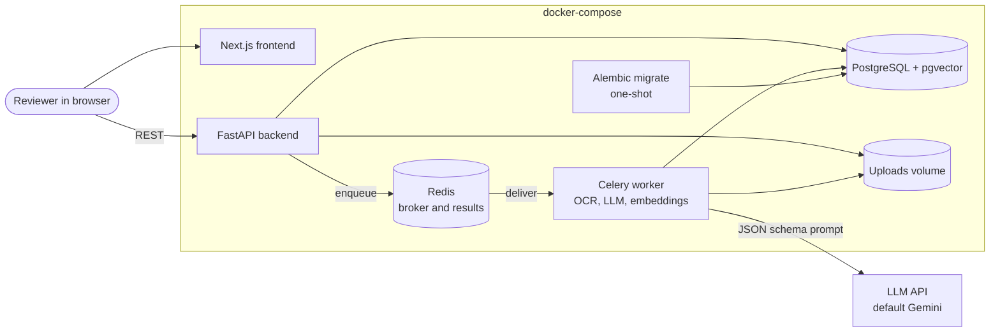
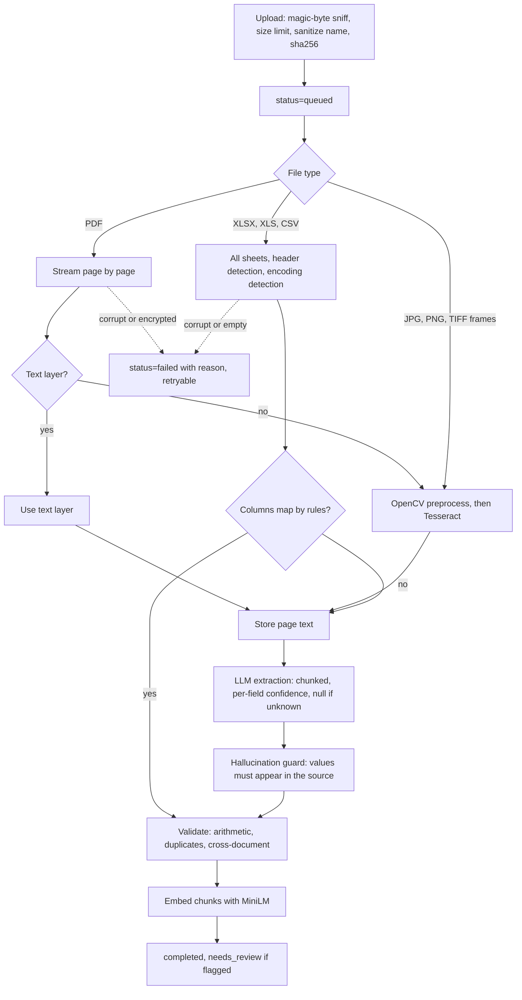
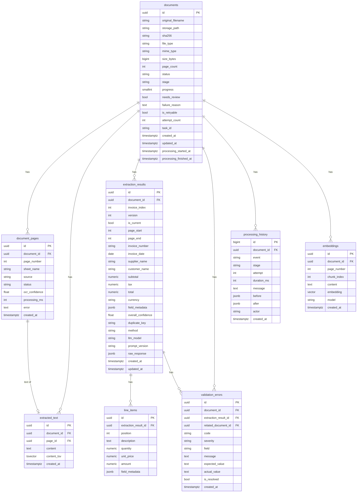

# Architecture

Status key: **built** exists in the repository today; **planned** is the design for a later phase (see [plan.md](plan.md)).

## System overview

The API only validates, stores and enqueues. Everything slow runs in workers, so scaling means adding worker replicas, and the API stays responsive while a 1000-page scan is being processed.

## Processing pipeline (planned, Phases 1 to 3)

## Database schema (built)

Migration: [0001_initial_schema.py](../backend/migrations/versions/0001_initial_schema.py). Models: [models.py](../backend/app/db/models.py). A test fails if the two drift apart.

`validation_errors.related_document_id` also references `documents`, naming the other file in a duplicate or cross-document finding. It becomes NULL if that file is deleted, so the finding survives.

`field_metadata` holds the per-field evidence: `{"total": {"confidence": 0.0, "reason": "not found", "source_snippet": null, "source_page": null}}`.

## Design decisions

| Decision | Why | Trade-off accepted |
|---|---|---|
| One document has many `extraction_results` (`invoice_index`, page range) | A 1000-page PDF is usually a batch of invoices, not one invoice | Results must be fetched per invoice, not per file |
| Results are versioned; a partial unique index allows one `is_current` row per invoice | Reprocessing must not destroy earlier results or corrections | More rows; queries must filter on `is_current` |
| Invoice fields are typed nullable columns plus `field_metadata` JSONB | Columns give arithmetic and filtering; `NULL` plus a reason means values are never invented | Field evidence is not relationally queryable |
| `NUMERIC(18,4)` for money | Floats cannot hold the 0.01 validation tolerance reliably | None worth noting |
| Duplicates are a non-unique `duplicate_key` hash | The rule is to flag duplicates for review, not to reject them | Enforced by application code, not by the database |
| One text row per page, not one blob per document | Pages stream in one at a time; search hits can cite a page; retries can resume | 1000 rows for a 1000-page PDF |
| Generated `tsvector` indexes only the first 200,000 characters of a page | Without this, a large sheet fails the INSERT. Measured: 7.9 MB vector against the 1 MB limit | Keyword search misses text beyond that prefix; the full text is still stored and embedded |
| pgvector rather than a separate vector database | One system to run and back up; filters and vectors can join in one query. HNSW keeps queries fast at this scale | Would need revisiting at hundreds of millions of vectors |
| VARCHAR + CHECK rather than native Postgres enums | Adding a value needs no `ALTER TYPE` | Slightly larger storage |
| Sync SQLAlchemy with psycopg3 for both API and workers | One set of models and sessions; the API does little work per request, and FastAPI runs sync routes in a threadpool | Lower peak connection concurrency than async, addressed by adding replicas |
| Celery `acks_late`, prefetch 1, Redis visibility timeout above the task time limit | A crashed worker's document is redelivered. A timeout shorter than the longest OCR job would run the same document twice at once | Tasks must be idempotent (Phase 3) |
| One-shot `migrate` service | Backend and worker replicas never race on migrations | One extra compose service |
| Postgres and Redis ports bind to loopback only | Neither should be reachable from the network; Redis has no password in this setup | Remote deployment would need a password and TLS |
| Readiness failure details go to logs only | The response must not expose hostnames or credentials | Diagnosing requires log access |
