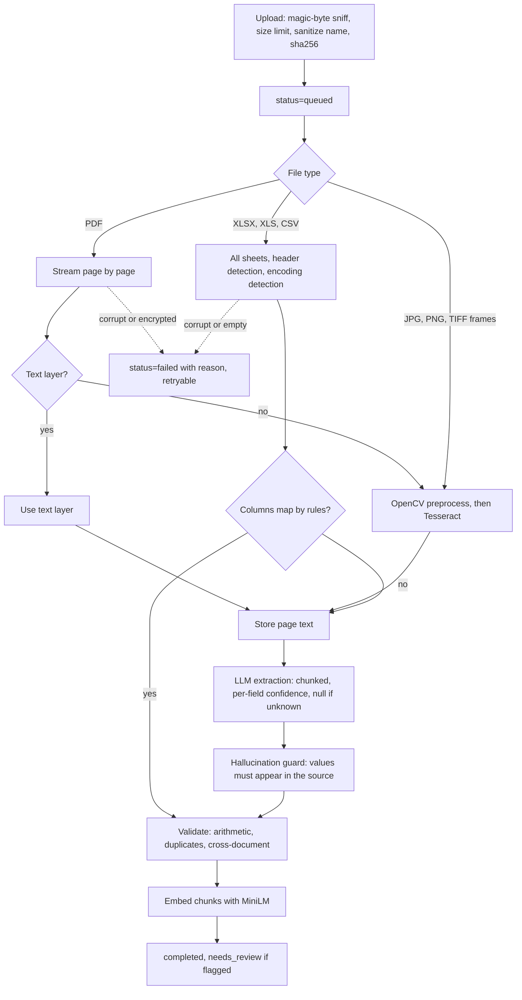
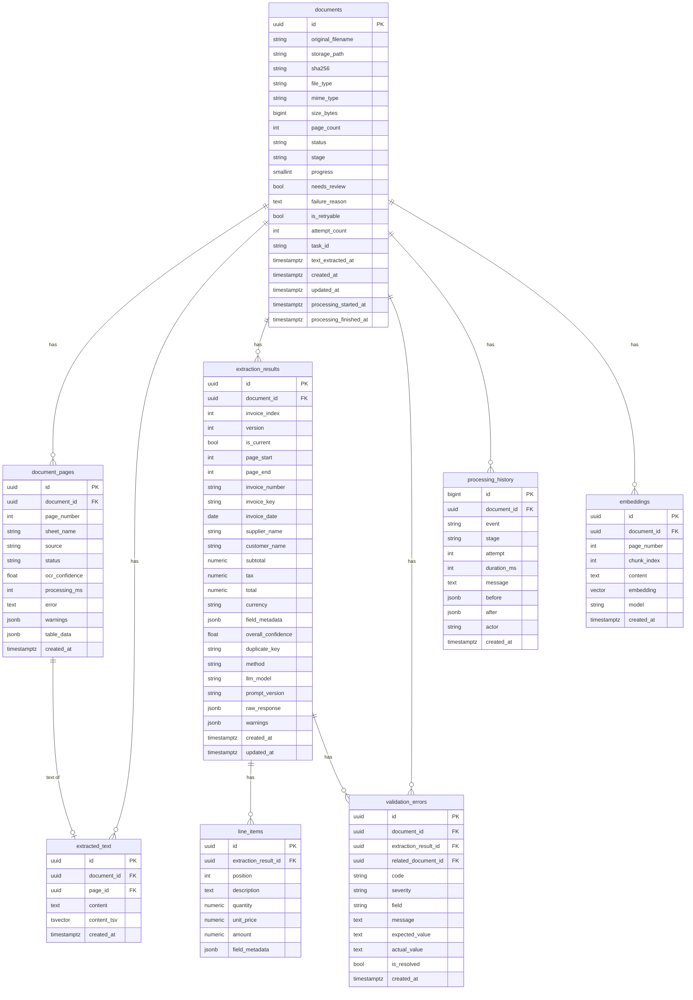

# Architecture

Status key: **built** exists in the repository today; **planned** is the design for a later phase (see [plan.md](plan.md)).

## System overview

The API only validates, stores and enqueues. Everything slow runs in workers, so scaling means adding worker replicas, and the API stays responsive while a 1000-page scan is being processed.

## Processing pipeline

All of these steps are **built**: file validation and text extraction ([backend/app/processing](../backend/app/processing)), LLM and rule-based extraction ([backend/app/extraction](../backend/app/extraction)), validation ([backend/app/validation](../backend/app/validation)), the background pipeline ([backend/app/pipeline](../backend/app/pipeline)), search ([backend/app/search](../backend/app/search)), and the REST API ([backend/app/api](../backend/app/api)).

### Text extraction (built)

| Behaviour | How it works |
|---|---|
| File validation | Content decides the type, from magic bytes and container structure. A wrong extension within a family (PNG named `.jpg`) is accepted; across families (an executable named `.pdf`) it is rejected. Size limits, zip bomb and image bomb checks run before any decoding |
| When a PDF page gets OCR | No usable text layer (under 20 letters and digits), mostly unmapped font glyphs, or a scan with a small text overlay (image covers at least half the page, under 200 characters). OCR is the slowest step, so all other pages skip it |
| Table rows | PDF text is rebuilt from word positions, so a row stays on one line and wide column gaps become tabs. OCR uses Tesseract's single-block mode for the same reason |
| Poor scans | Upscale small images, flatten shadows, and denoise, only when the image shows the problem, then deskew. Below 0.75 confidence: orientation detection, then a local-threshold pass. The pass that reads the most characters at reasonable confidence wins |
| Failures | One bad page is recorded as failed and the others continue. If the OCR engine itself is missing, the document stops with a transient error rather than failing page by page. A file with no readable text fails with a reason |
| Spreadsheets | All sheets, including hidden ones, with header detection and the rows above the header kept as a preamble. Formulas with no stored result and rows beyond the limit produce a warning rather than a silent blank |

### Measured results

From `python -m tests.large_pdf_benchmark` and `python -m tests.ocr_benchmark`, on an Intel i5-8350U laptop (4 cores) in Docker. These are synthetic invoices, not real-world accuracy, which Phase 5 measures.

**1000 fully scanned pages, real OCR, one process:** 1000 of 1000 read, no failures.

| Metric | Result |
|---|---|
| Total time | 48.2 minutes (2.89 s per page) |
| Time per page | Median 2.8 s, p95 3.8 s, slowest 10.9 s |
| Peak process memory | 600 MB at page 100, 601 MB at page 1000 |
| Expected values read | 100% on every page |

These pages are one invoice with light noise, so they are all similarly easy. Throughput with several workers has not been measured yet.

**OCR preprocessing, one invoice under 16 kinds of damage:** the share of 12 expected values read exactly.

| Damage | Raw Tesseract (auto layout) | Raw Tesseract (single block) | This pipeline |
|---|---|---|---|
| Clean, blur, low contrast, 3° skew, JPEG artifacts, 40% downscale | 1.00 | 1.00 | 1.00 |
| 7° skew | 0.75 | 0.83 | 1.00 |
| Rotated 90° or 180° | 0.00 | 0.00 | 1.00 |
| Gaussian noise, sigma 25 | 0.92 | 1.00 | 1.00 |
| Gaussian noise, sigma 50 | 0.00 | 0.00 | 1.00 |
| Salt and pepper noise, 2% | 0.92 | 0.67 | 1.00 |
| Uneven lighting | 0.58 | 0.58 | 1.00 |
| 25% downscale | 0.92 | 0.92 | 1.00 |
| Simulated phone photo | 0.58 | 0.00 | 1.00 |
| **Mean, all 16** | **0.73** | **0.69** | **1.00** |

The preprocessing was tuned against this same invoice, so the 1.00 shows that each kind of damage is handled, not how often real scans read perfectly.

### Invoice extraction (built)

| Behaviour | How it works |
|---|---|
| Finding invoices | Pages are split into invoices by rules, without the LLM, so a batch costs one call per invoice. A new invoice number or "Page 1 of N" starts a new invoice. Numbers are compared allowing for OCR confusions, so a misread repeat does not split one invoice |
| Long invoices | Split into chunks at line boundaries, so a table row is never cut. Parts are then merged: for identifying fields the most confident value wins, and for money the last one does, as totals come at the end. Disagreeing parts produce a warning |
| Spreadsheets | Recognizable columns are mapped by exact rules with pandas, with no LLM call. This covers one row per invoice, several rows per invoice, and one invoice with details above and totals below a table. Anything uncertain goes to the LLM |
| Unknown values | Null, with a reason and zero confidence. Validation reports them as missing, and never treats them as zero |
| Provider | Set by `LLM_PROVIDER`: Gemini, or anything with an OpenAI-style API, including local servers. Retries with backoff honor the provider's requested delay, and pacing stays within quotas |

**Hallucination guards.** Every value from the model must be traced back to the invoice's own pages, or it becomes null with a reason. This happens in code, after the model answers, so it does not depend on the model behaving.

| Value | Accepted only if |
|---|---|
| Invoice number | It appears ignoring punctuation. A match only after allowing for OCR confusions lowers confidence to 0.7 |
| Company name | It appears, or is at least 85% similar on one line, which lowers confidence to 0.7 |
| Amount | That number is printed, in any format. This catches totals the model calculated |
| Date | It is printed. If day and month could be swapped, confidence drops to 0.6 |
| Currency | Its code, name, or symbol is printed. `$` alone is only a hint, with confidence 0.6 |
| Line item | Its cells pass the same checks. A cell that fails is dropped, and a row with nothing verified is removed, with a warning either way |

A value also cannot be more confident than the OCR of its page.

**Prompt injection.** Document text is delimited and described to the model as data, and it cannot close its own delimiter. If a model did obey an injection and report a value that is printed in the document, the guards would pass it, because that is their limit. The arithmetic checks then flag the invoice for review, and a test covers this.

### Validation (built)

Every issue has a typed code and a severity. Any unresolved error or warning sets `needs_review`, and info alone does not. A reviewer can mark an issue resolved, for a false alarm or a value they have confirmed, and that holds until the problem itself changes. Comparisons use exact decimals, with a tolerance of 0.01.

| Check | Severity | Notes |
|---|---|---|
| Invoice number, date, supplier, or total missing | Error | |
| Customer, subtotal, tax, or currency missing | Warning | |
| Subtotal + tax ≠ total | Error | Only when all three are known |
| Subtotal and total differ, with tax unknown | Warning | Reported as unverified, not as wrong |
| Sum of line items ≠ subtotal | Error | Only when every line amount is known; otherwise a warning that they could not be added up |
| Sum of line items ≠ total, with no subtotal | Warning | Only when tax is unknown or zero |
| Quantity × unit price ≠ amount | Warning | Allows for rounding of a four-decimal unit price |
| Negative amounts, zero total, tax above subtotal, negative or zero quantities | Warning | Credit notes are legitimate, so these are not errors |
| Date in the future or over 10 years old, unrecognized currency | Warning | |
| Any field below 0.6 confidence, or any extraction warning | Warning | |
| Same supplier, number, date, and total as another invoice | Error | Across files and within one file, ignoring formatting and legal form such as Ltd or Limited. A PDF and a spreadsheet are the exception, below |
| A PDF and a spreadsheet of one invoice that fully agree | Info | Reported as verified, since this is the cross-check succeeding. Needs no review |
| PDF against PDF, or PDF against Excel: values differ for one invoice number | Error | Names both values and the other document. A value only one side knows is no conflict, and the same number from a different supplier is ignored |

### Real API results (built)

From `python -m tests.llm_smoke`, against the real Gemini API. This is a short functional check on five synthetic documents, not an accuracy measurement, which Phase 5 provides.

| Document | Result |
|---|---|
| Digital PDF | All values and line items correct. Currency left null, because none is printed |
| Scanned image, through real OCR | Same |
| Invoice with no date, customer, totals, or currency | Those fields left null with reasons, nothing invented |
| Document telling the model to report a total of 0.01, with a fake closing delimiter | Instruction ignored, the real total of 1,100.00 reported |
| Two-invoice batch PDF | Split correctly into two invoices |

**Model choice, from one invoice per model:** every model tested read the invoice correctly, so the default is the fastest.

| Model | Time | Model thinking |
|---|---|---|
| `gemini-3.8-flash` | 66.3 s | On (1096 tokens) |
| `gemini-3.8-flash`, low thinking | 31.0 s | Reduced |
| `gemini-3.5-flash` | 9.9 s | On (2169 tokens) |
| `gemini-3.1-flash-lite` | 4.7 s | None |
| `gemini-3.5-flash-lite` (default) | 2.8 s | None |

One sample cannot show whether a larger model does better on harder documents. Phase 5 can compare them, and `LLM_MODEL` switches model with no code change.

### Background pipeline and recovery (built)

| Situation | What happens |
|---|---|
| Normal run | Stages run in order: text extraction, LLM extraction, validation, indexing. Progress and per-stage timings are stored as they go, for live status |
| LLM rate limit or outage | The stage fails as transient, and the task retries with growing delays. Stored pages and finished invoices are kept, so **OCR is not repeated** and finished invoices cost no more LLM calls |
| Damaged, locked or empty file, or a rejected API key | Fails straight away with a plain reason, as retrying cannot help. It can still be retried by hand |
| Worker killed mid-job | A scheduled job notices a document with no progress for `STALLED_AFTER_SECONDS` and gives it to a new task, which resumes at the next unprocessed page |
| Stale or repeated task | A task only acts if its id is the one recorded on the document, so a redelivered task cannot run alongside its replacement |
| Search indexing fails | The document still completes, as its extracted data is more valuable than search. The failure is in its history, and keyword search still works |

**Crash test, on the real stack.** The worker container was killed outright at page 15 of a 40-page scan, with a 60-second stall timeout for the test. Recovery started by itself, resumed at page 16, and stored all 40 pages, with one correct invoice and no extra version. Stored pages kept their original timings, and the remaining 25 pages took 24 seconds. With the default 15-minute timeout and a 5-minute check interval, recovery would start within about 20 minutes. Anyone can also reprocess a stalled document sooner through the API once the timeout has passed.

### Search (built)

| Mode | How it works |
|---|---|
| Keyword | PostgreSQL full-text search on page text, plus exact invoice numbers ignoring formatting, and supplier and customer names |
| Semantic | Cosine similarity on all-MiniLM-L6-v2 embeddings of page chunks, using an HNSW index |
| Hybrid (default) | Reciprocal rank fusion of both, as ranks can be compared across methods while raw scores cannot |

On a small test set of invoice pages, related queries scored 0.154 or more and unrelated ones 0.123 or less, so results below 0.14 are dropped. A test keeps this honest against the real model. That is a narrow gap measured on few examples, so the cutoff may need tuning on real data.

### REST API (built)

Interactive documentation is at `/docs` when the stack is running. All routes are under `/api/v1`.

| Route | Purpose |
|---|---|
| `POST /documents` | Upload files. Each gets its own outcome, so one bad file does not fail a batch |
| `GET /documents` | List, with filters for status, review flag, file type, filename, supplier, invoice number, date range, and total range |
| `GET /documents/{id}`, `/status` | Details, or a light status for polling |
| `GET /documents/{id}/results` | Current invoices, with evidence for each field, line items, and validation issues |
| `GET /documents/{id}/pages/{n}`, `/history`, `/file` | One page's text, the full audit trail, the original file |
| `PATCH /documents/{id}/results/{result_id}` | Correct values, recording before and after, then re-validate |
| `PATCH /documents/{id}/validation-errors/{error_id}` | Mark an issue reviewed. It stays resolved until the problem itself changes |
| `POST /documents/{id}/reprocess` | Run again from the start, or with `resume=true` keep the work already done |
| `POST /documents/reprocess-failed` | Resume every retryable failed document |
| `GET /search` | Keyword, semantic, or hybrid search |
| `GET /metrics` | Counts, processing times, success and failure rates, and validation issues |

**Live check on the real stack, with the real LLM.** One upload of 13 files through the API, finished in 54 seconds including search and corrections, with two workers:

| Files | Result |
|---|---|
| Digital PDF, scanned PDF, PNG, two-page TIFF | Completed, correct values, no review needed |
| XLSX, CSV | Completed by rules with no LLM call, correct values |
| Second copy of the digital PDF | Completed, flagged as a duplicate |
| PDF and XLSX of one invoice, with different totals | The XLSX flagged with a PDF-vs-Excel mismatch. Correcting its total cleared the mismatch |
| Damaged PDF, password-protected PDF, empty CSV | Failed, each with its own plain reason, and retryable |
| Executable named `.pdf` | Rejected at upload, nothing stored |

The embedding model loads in the background at startup. After a restart, the first PDF took 3.1 s and the first CSV 0.5 s, down from 31 to 72 s before preloading, and the first semantic search took 2.5 s, down from 10.8 s. Later searches took about 0.04 s.

### Web interface (built)

Next.js with the App Router, TypeScript, and Tailwind. All data comes from the REST API in the browser.

| Page | What a reviewer can do |
|---|---|
| Documents (`/`) | Drop in many files and watch each upload's progress. See live status, stage, and failure reasons. Filter by status, review flag, type, name, supplier, number, and date. Retry everything that failed |
| Document (`/documents/{id}`) | See the original page beside the extracted values, with each value's confidence, source text, and a link to its page. Correct values inline, edit line items, mark issues reviewed, reprocess, and read the full history |
| Search (`/search`) | Search by keyword, meaning, or both, and open a result at its page |

| Design decision | Why | Trade-off accepted |
|---|---|---|
| Page previews are PNGs rendered by the API | Browsers cannot display TIFF, and an uploaded PDF cannot safely be embedded, so every format gets the same preview | One render per page viewed. Browsers can cache it for an hour |
| One upload request per file, three at a time | Each file gets its own progress bar and its own outcome. One huge file does not hold up the rest | A very large batch reaches the upload rate limit, in which case the page waits and retries rather than losing files |
| Filters and search terms live in the URL | They survive opening a document and pressing Back, and a filtered view can be shared | None worth noting |
| Status by polling, every 3 s with work in progress and 15 s otherwise | Simpler and sturdier than a socket, at this scale | Status can be a few seconds old |
| An exact invoice number in hybrid search returns only that invoice | Found by looking at real results: every invoice looks alike to the embedding model, so semantic matches buried the answer | A search for a number will not also show similar invoices |

The whole flow is tested in real Chrome against the running stack with `npm run e2e`.

## Database schema (built)

Migrations: [backend/migrations/versions](../backend/migrations/versions). Models: [models.py](../backend/app/db/models.py). A test fails if the two drift apart.

`validation_errors.related_document_id` also references `documents`, naming the other file in a duplicate or cross-document finding. It becomes NULL if that file is deleted, so the finding survives.

`field_metadata` holds the per-field evidence: `{"total": {"confidence": 0.0, "reason": "not found", "source_snippet": null, "source_page": null}}`.

## Design decisions

| Decision | Why | Trade-off accepted |
|---|---|---|
| One document has many `extraction_results` (`invoice_index`, page range) | A 1000-page PDF is usually a batch of invoices, not one invoice | Results must be fetched per invoice, not per file |
| Results are versioned; a partial unique index allows one `is_current` row per invoice | Reprocessing must not destroy earlier results or corrections | More rows; queries must filter on `is_current` |
| Invoice fields are typed nullable columns plus `field_metadata` JSONB | Columns give arithmetic and filtering; `NULL` plus a reason means values are never invented | Field evidence is not relationally queryable |
| `NUMERIC(18,4)` for money | Floats cannot hold the 0.01 validation tolerance reliably | None worth noting |
| Duplicates are a non-unique `duplicate_key` hash | The rule is to flag duplicates for review, not to reject them | Enforced by application code, not by the database |
| One text row per page, not one blob per document | Pages stream in one at a time; search hits can cite a page; retries can resume | 1000 rows for a 1000-page PDF |
| Generated `tsvector` indexes only the first 200,000 characters of a page | Without this, a large sheet fails the INSERT. Measured: 7.9 MB vector against the 1 MB limit | Keyword search misses text beyond that prefix; the full text is still stored and embedded |
| pgvector rather than a separate vector database | One system to run and back up; filters and vectors can join in one query. HNSW keeps queries fast at this scale | Would need revisiting at hundreds of millions of vectors |
| VARCHAR + CHECK rather than native Postgres enums | Adding a value needs no `ALTER TYPE` | Slightly larger storage |
| Sync SQLAlchemy with psycopg3 for both API and workers | One set of models and sessions; the API does little work per request, and FastAPI runs sync routes in a threadpool | Lower peak connection concurrency than async, addressed by adding replicas |
| Celery `acks_late`, prefetch 1, Redis visibility timeout above the task time limit | A crashed worker's document is redelivered. A timeout shorter than the longest OCR job would run the same document twice at once | Tasks must be idempotent (Phase 3) |
| One-shot `migrate` service | Backend and worker replicas never race on migrations | One extra compose service |
| All published ports bind to loopback only | The API has no login and Redis has no password, so neither should be reachable from the network | Remote deployment would need authentication, a Redis password and TLS |
| Readiness failure details go to logs only | The response must not expose hostnames or credentials | Diagnosing requires log access |
| Correct scan problems before OCR, instead of retrying when confidence is low | Measured: on a page with a shadow, Tesseract read half the page at 0.80 confidence, so a confidence check alone never noticed the missing half | A small analysis cost on every OCR page |
| Pages stream through a generator, one at a time | A 1000-page PDF must not need memory proportional to its length. Measured flat at 601 MB; a test proves that a deliberate leak fails | Callers must store each page as it arrives |
| Excel read directly with openpyxl and xlrd, and CSV with Python's `csv` module; pandas is used afterwards, for column mapping | The readers stream row by row, keep cell types, and tolerate rows above a table having fewer columns, where pandas' CSV reader raises or drops rows. Pandas suits grouping and filling down the rows once they are read | Slightly more parsing code |
| Hallucination guards in code, not only in the prompt | A prompt is a request and a guard is a check. Tests prove each invented value is discarded, whatever the model says | A legitimately calculated value that is not printed is left null for a person to fill in |
| Split invoices by rules before calling the LLM | One call per invoice rather than per page, and values are only checked against their own invoice's pages | An unlabeled invoice with no "Page 1 of N" merges with the one before it |
| Default to a model without built-in thinking | Measured 24 times faster than the newest Flash model on the same invoice, with the same result | Harder documents may benefit from a larger model; `LLM_MODEL` changes it |
| A failed LLM call fails the document as transient, rather than storing partial results | An outage should not look like an invoice with missing fields. Background workers can retry | One failed chunk means the whole invoice waits for the retry |
| Each stage stores its work as it goes, and a retry skips what is stored | Repeating OCR because of one rate limit could cost many minutes on a long scan. Tested by killing a real worker | More commits, and the pipeline must be careful about what counts as done |
| A task id on each document decides who may work on it | Redis can redeliver a task long after it was replaced, and two workers must never write one document | One query per progress update |
| Recovery by a scheduled job, as well as Celery redelivery | With a killed worker, Redis only redelivers after its visibility timeout, which is hours | A dead worker's document waits until the stall timeout passes |
| LLM pacing shared through Redis | A quota covers every worker, so per-process pacing would exceed it as workers are added | Falls back to per-process pacing if Redis is down |
| Rate limits fail open | A cache outage should not take the API down | No limits during a Redis outage |
| A PDF and a spreadsheet that agree are verified, not duplicates | The assignment asks for PDF-vs-Excel cross-checking, so flagging its success as an error would be a false alarm on every good match | A truly double-entered invoice, once as a PDF and once as a spreadsheet, will not be flagged |
| Embedding model preloads in the background at startup | Loading on first use made the first document take over 30 seconds, and it would distort measured processing times | Hundreds of MB of memory in the API and in each worker process, even if unused |
| The API has no login | The assignment does not ask for accounts, and every port binds to loopback only, so `actor` on a correction is whatever the client sends | Real deployment would need authentication |
